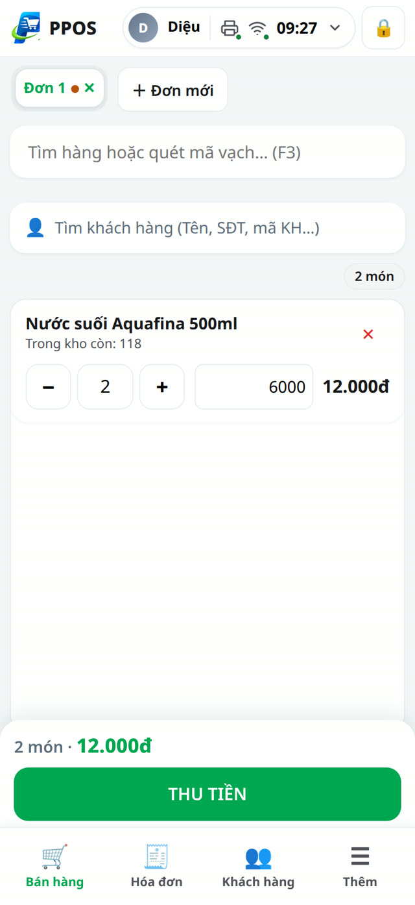

# PPOS — Phần mềm bán hàng offline

**Bán hàng không cần internet.** PPOS chạy ngay trên máy tính của quán: máy quầy làm máy chủ trong quán, điện thoại của nhân viên bán chung một kho qua mạng Wi-Fi nội bộ — mất mạng vẫn bán bình thường, dữ liệu luôn nằm trên máy của quán.

  

## ⬇️ Tải về

- **Tải bản cài đặt mới nhất:** vào mục **[Releases](https://github.com/toolbox86/ppos-releases/releases)** của kho này và tải file `PPOS.exe`.
- **Trang giới thiệu & bảng giá:** [ppos-landing.vercel.app](https://ppos-landing.vercel.app)

## 🆕 Có gì mới trong bản v2.43

- **Tờ khai và sổ sách thuế ra đúng mẫu nhà nước** — tờ khai 01/CNKD trình bày đúng mẫu giấy như trong HTKK (đủ thông tin quán, kê khai theo nhóm ngành, các khoản giảm thuế, số tiền thực nộp); sổ kế toán Thông tư 152/2025 dựng lại đúng biểu mẫu gốc (đủ khối "Mẫu số", đúng từng cột, dòng tổng, phần ký) ở cả màn hình, Excel và bản in.
- **File XML 01/CNKD chốt theo HTKK hiện hành** — viết lại theo đúng một file XML thật do HTKK 5.5.4 kết xuất (mã tờ khai 473), nạp vào HTKK / Thuế điện tử để kiểm tra, ký và nộp.
- **Mới: nút "Tải PDF"** cho tờ khai và mọi sổ kế toán — file PDF mở máy nào cũng giống hệt nhau, in ra giấy đúng khổ A4 (sổ hàng hóa S2d tự sang khổ ngang), tiện gửi cho kế toán hoặc lưu hồ sơ.
- **Sửa lỗi xuất Excel trong toàn app** — hết hiện số kiểu 5.25E+08 và cắt chữ ở mọi báo cáo; cột nay tự giãn, số có dấu phân cách rõ ràng. Kèm vá một lỗi in ấn cũ khiến bản in lọt thêm một trang trắng.
- **Cách lên 2.43:** máy đang dùng bản 2.26 trở lên sẽ thấy thông báo có phiên bản mới **ngay trong phần mềm** — bấm **Cập nhật ngay** là xong, không phải tải lại file cài đặt. Khách mới tải file `PPOS.exe` của bản này. **Dữ liệu bán hàng giữ nguyên tuyệt đối.**

Xem chi tiết: [Release v2.43](https://github.com/toolbox86/ppos-releases/releases/tag/v2.43)

## 🆕 Có gì mới trong bản v2.42

- **Thuế & Kế toán: tự lập sổ sách và tờ khai thuế** — menu "Tiền & Thuế" → Thuế & Kế toán: Tổng quan thuế tạm tính cả năm, Sổ kế toán theo Thông tư 152/2025/TT-BTC (S1a, S2a–S2e, sổ theo dõi nộp thuế) tải được Excel và in được, Tờ khai thuế tự lập 01/CNKD (Thông tư 50/2026/TT-BTC) kèm phụ lục giảm thuế GTGT và giảm 30% TNCN, thông báo doanh thu, quyết toán TNCN năm và bảng kê tài khoản. Phân loại thuế theo nhóm hàng (6 nhóm ngành), sổ và tờ khai tự tách theo từng nhóm.
- **Gói Business:** xuất file XML 01/CNKD (bản thử nghiệm), nhắc hạn nộp tờ khai, ghi nhận đã nộp và khóa kỳ. Sổ kế toán + tờ khai (xem trước, Excel, in) ở gói Pro trở lên.
- **Vá lỗi vân tay máy:** máy mới đôi khi không gửi được vân tay máy về máy chủ bản quyền trong ngày đầu — đã vá, vân tay tới muộn hoặc thay đổi do thay phần cứng sẽ tự gửi bổ sung ngay.
- **Cách lên 2.42:** máy đang dùng bản 2.26 trở lên sẽ thấy thông báo có phiên bản mới **ngay trong phần mềm** — bấm **Cập nhật ngay** là xong, không phải tải lại file cài đặt. Khách mới tải file `PPOS.exe` của bản này. **Dữ liệu bán hàng giữ nguyên tuyệt đối.**

Xem chi tiết: [Release v2.42](https://github.com/toolbox86/ppos-releases/releases/tag/v2.42)

## 🆕 Có gì mới trong bản v2.41

- **Cài mới là đăng ký tài khoản PPOS ngay trong phần mềm** — khách mới mở PPOS lần đầu sẽ đăng ký tài khoản miễn phí (khoảng 1 phút, cần internet cho bước này), đăng nhập lại rồi đặt mã PIN mới vào bán hàng. Tài khoản giúp quán nhận mã nâng cấp đúng máy, được hỗ trợ tận nơi và chuyển máy dễ dàng về sau. **Quán đang dùng PPOS rồi cập nhật lên vẫn vào thẳng bằng mã PIN như cũ — không phải đăng ký lại**, dữ liệu giữ nguyên.
- **Cách lên 2.41:** máy đang dùng bản 2.26 trở lên sẽ thấy thông báo có phiên bản mới **ngay trong phần mềm** — bấm **Cập nhật ngay** là xong, không phải tải lại file cài đặt. Khách mới tải file `PPOS.exe` của bản này. **Dữ liệu bán hàng giữ nguyên tuyệt đối.**

## Vì sao chủ quán chọn PPOS?

- 📶 **Mất mạng, mất điện giữa chừng vẫn bán** — phần mềm chạy offline ngay trên máy của quán, không phụ thuộc internet hay máy chủ bên ngoài.
- 🔓 **Không bị ép thuê bao, dữ liệu không bị giữ làm con tin** — hết hạn gói, phần mềm không khóa đột ngột; bạn vẫn bán bằng gói Free và xuất dữ liệu ra file bất cứ lúc nào.
- 🧾 **In hóa đơn ngay tại quầy** — thu tiền, ghi nợ, thu nợ từng phần và in phiếu thu nợ rõ ràng.
- 📦 **Quản lý kho theo lô & hạn dùng** — bán trừ lô cũ nhất trước (FEFO), hàng sắp hết hạn được đánh dấu để xử lý kịp.
- ⭐ **Tích điểm & xếp hạng khách hàng** — điểm tích lũy, quà đổi điểm, giá sỉ theo hạng khách.
- 🕐 **Chấm công & tính lương ngay trong phần mềm** — xếp ca, đơn từ, tăng ca, tạm ứng và tính lương theo tháng/ca/giờ (gói Business).
- 🧮 **Sổ thuế hộ kinh doanh tự tính** — doanh thu tổng hợp tự động từ bán hàng, dự kiến thuế phải nộp theo quy định hộ kinh doanh.

*Trang tổng quan — mở máy là thấy toàn cảnh quán hôm nay.*

*Màn hình bán hàng trên máy quầy — tổng tiền, cách trả và tiền thừa trả khách hiện rõ.*

