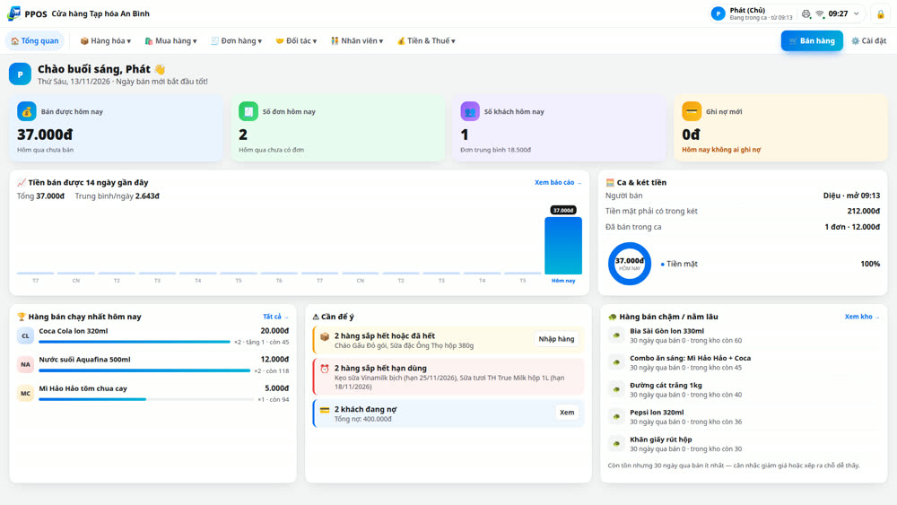
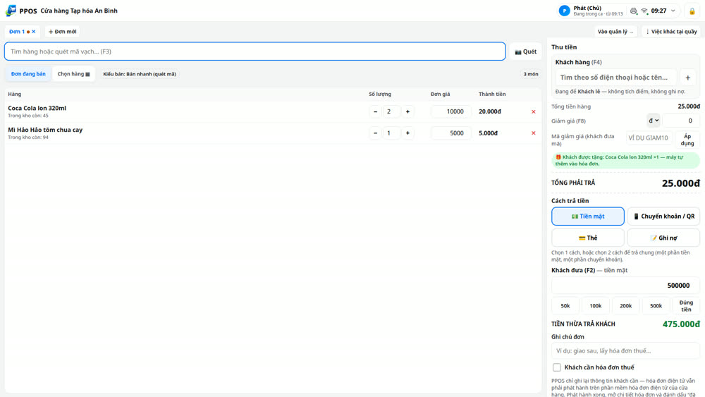

# PPOS — Phần mềm bán hàng offline

**Bán hàng không cần internet.** PPOS chạy ngay trên máy tính của quán: máy quầy làm máy chủ trong quán, điện thoại của nhân viên bán chung một kho qua mạng Wi-Fi nội bộ — mất mạng vẫn bán bình thường, dữ liệu luôn nằm trên máy của quán.

  

## ⬇️ Tải về

- **Tải bản cài đặt mới nhất:** vào mục **[Releases](https://github.com/toolbox86/ppos-releases/releases)** của kho này và tải file `PPOS.exe`.
- **Trang giới thiệu & bảng giá:** [ppos-landing.vercel.app](https://ppos-landing.vercel.app)

## 🆕 Có gì mới trong bản v2.35

Bản **đổi bố cục 3 màn tạo phiếu** — thuần giao diện, nghiệp vụ giữ nguyên tuyệt đối (đã kiểm chứng bằng bộ ca tự động lái trọn 3 luồng ở bản cũ và bản mới: mọi con số khớp tuyệt đối):

- **Phiếu nhập hàng, phiên kiểm kho và phiếu trả hàng cho nhà cung cấp** nay dùng bố cục 2 cột giống màn Bán hàng: bên trái là vùng tìm hàng và bảng dòng, bên phải là cột phiếu cố định gồm thông tin phiếu, các con số tổng kết và **nút chốt phiếu luôn nhìn thấy** — không phải cuộn xuống cuối trang mới bấm được.
- Mọi thao tác giữ nguyên đúng như trước: thêm hàng, sửa số lượng/giá/hạn dùng, chọn lô, cách tính tiền, trừ kho, trừ công nợ và chốt kiểm kho không thay đổi chút nào — chỉ dời vị trí các ô trên màn hình cho thuận tiện. Phiếu nháp đang nhập dở ở bản cũ mở lên bản này nhập tiếp bình thường.
- **Cách lên 2.35:** máy đang dùng bản 2.26 trở lên sẽ thấy thông báo có phiên bản mới **ngay trong phần mềm** — bấm **Cập nhật ngay** là xong, không phải tải lại file cài đặt. Khách mới tải file `PPOS.exe` của bản này. **Dữ liệu bán hàng giữ nguyên tuyệt đối.**

## Vì sao chủ quán chọn PPOS?

- 📶 **Mất mạng, mất điện giữa chừng vẫn bán** — phần mềm chạy offline ngay trên máy của quán, không phụ thuộc internet hay máy chủ bên ngoài.
- 🔓 **Không bị ép thuê bao, dữ liệu không bị giữ làm con tin** — hết hạn gói, phần mềm không khóa đột ngột; bạn vẫn bán bằng gói Free và xuất dữ liệu ra file bất cứ lúc nào.
- 🧾 **In hóa đơn ngay tại quầy** — thu tiền, ghi nợ, thu nợ từng phần và in phiếu thu nợ rõ ràng.
- 📦 **Quản lý kho theo lô & hạn dùng** — bán trừ lô cũ nhất trước (FEFO), hàng sắp hết hạn được đánh dấu để xử lý kịp.
- ⭐ **Tích điểm & xếp hạng khách hàng** — điểm tích lũy, quà đổi điểm, giá sỉ theo hạng khách.
- 🕐 **Chấm công & tính lương ngay trong phần mềm** — xếp ca, đơn từ, tăng ca, tạm ứng và tính lương theo tháng/ca/giờ (gói Business).
- 🧮 **Sổ thuế hộ kinh doanh tự tính** — doanh thu tổng hợp tự động từ bán hàng, dự kiến thuế phải nộp theo quy định hộ kinh doanh.

*Trang tổng quan — mở máy là thấy toàn cảnh quán hôm nay.*

*Màn hình bán hàng trên máy quầy — tổng tiền, cách trả và tiền thừa trả khách hiện rõ.*

*Bán hàng trên điện thoại — nhân viên bán chung một kho với máy quầy qua Wi-Fi trong quán.*

## Bảng giá

Giá tính theo cửa hàng, không tính theo người dùng, không phí ẩn:

| Gói | Giá |
|---|---|
| **Free** | 0đ — miễn phí vĩnh viễn |
| **Pro** | 3.990.000đ — mua vĩnh viễn, trả một lần |
| **Business** | 4.990.000đ — mua vĩnh viễn, trả một lần |

PPOS chỉ bán **vĩnh viễn** (từ 14/11/2026): mua một lần, dùng trọn đời, mọi bản cập nhật về sau vẫn giữ nguyên gói — không bán theo tháng/năm, không phí duy trì hằng năm. Có **dùng thử Business 14 ngày miễn phí** (liên hệ Zalo ở trang giới thiệu).

> Cam kết: gói mua vĩnh viễn **không bao giờ hết hạn** — phần mềm không bị khóa vì hết hạn gói; dữ liệu luôn nằm trên máy tính của quán và xuất ra file được bất cứ lúc nào. Hỗ trợ kỹ thuật vĩnh viễn.

Chi tiết so sánh từng tính năng: [xem bảng giá đầy đủ](https://ppos-landing.vercel.app/bang-gia).

## Cài đặt trong 3 bước

1. **Tải** file `PPOS.exe` từ mục [Releases](https://github.com/toolbox86/ppos-releases/releases).
2. **Chạy file** để cài đặt trên máy tính Windows 10/11 của quán.
3. **Mở PPOS** và dùng ngay gói Free miễn phí vĩnh viễn — hoặc nhập mã bản quyền trong phần mềm để nâng lên gói Pro / Business.

## 📚 Nguồn tham khảo & ghi công

PPOS là phần mềm được **phát triển độc lập**. Trong quá trình xây dựng, danh mục tính năng của PPOS đã được đối chiếu và tham khảo từ **ERPNext** — một trong những hệ thống ERP mã nguồn mở phổ biến nhất thế giới — để bảo đảm bao quát đầy đủ nghiệp vụ bán hàng, kho và nhân sự cho cửa hàng nhỏ (đợt kiểm tra chất lượng đối soát 69 tính năng). PPOS **không sao chép mã nguồn của ERPNext** — phần ghi công này là lời cảm ơn dành cho nguồn tham khảo tính năng đó.

| 🔗 Nguồn tham khảo | Liên kết |
|---|---|
| 🌐 Trang chủ ERPNext | [erpnext.com](https://erpnext.com) |
| 💻 Mã nguồn ERPNext trên GitHub | [github.com/frappe/erpnext](https://github.com/frappe/erpnext) |
| 🏢 Đơn vị phát triển — Frappe | [frappe.io](https://frappe.io) |
| 📜 Giấy phép GNU GPL v3 (toàn văn) | [gnu.org/licenses/gpl-3.0.html](https://www.gnu.org/licenses/gpl-3.0.html) |

> **⚖️ Về giấy phép:** ERPNext được phân phối theo giấy phép **GNU GPL v3**. PPOS tôn trọng giấy phép này và thực hiện ghi công cho phần tham khảo tính năng nêu trên. Vì PPOS không sao chép mã nguồn ERPNext, mã nguồn của PPOS không thuộc phạm vi điều chỉnh của GNU GPL v3.
>
> **™️ Về nhãn hiệu:** "ERPNext" là nhãn hiệu của **Frappe Technologies Pvt. Ltd.** PPOS không phải là sản phẩm của Frappe và không được Frappe bảo trợ hay chứng thực.

## ⚖️ Bản quyền & điều khoản sử dụng

PPOS là phần mềm thương mại **© 2026 Nguyễn Tấn Phát** — **không phải phần mềm mã nguồn mở**. Người dùng được tải, cài đặt và sử dụng PPOS theo phạm vi gói bản quyền của mình (Free / Pro / Business); nghiêm cấm sao chép, phân phối lại, dịch ngược và vô hiệu hóa cơ chế bản quyền. Toàn văn điều khoản: xem file [LICENSE](LICENSE).

## Hỗ trợ

- 💬 Zalo: **0986 495 913**
- ✉️ Email: **phatnt056@gmail.com**
- 📘 Facebook: [facebook.com/phatnt056](https://facebook.com/phatnt056)
- 📖 Trang hướng dẫn: [ppos-landing.vercel.app/huong-dan](https://ppos-landing.vercel.app/huong-dan)

---

*Kho này chỉ chứa các bản phát hành của PPOS để tải về — không chứa mã nguồn của phần mềm.*

© 2026 Nguyễn Tấn Phát — PPOS · Bảo lưu mọi quyền.
